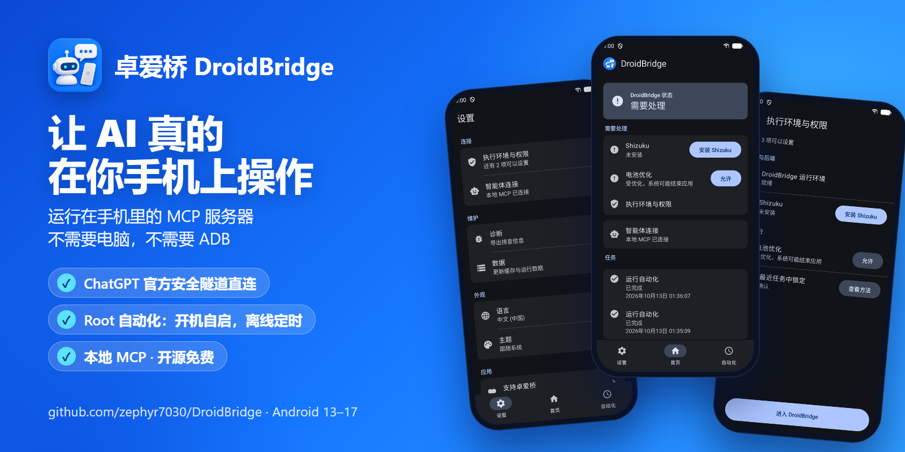
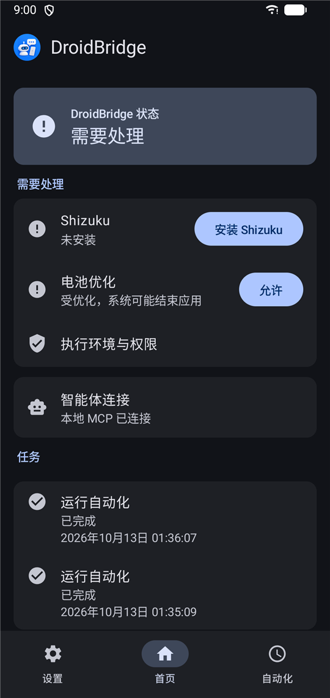
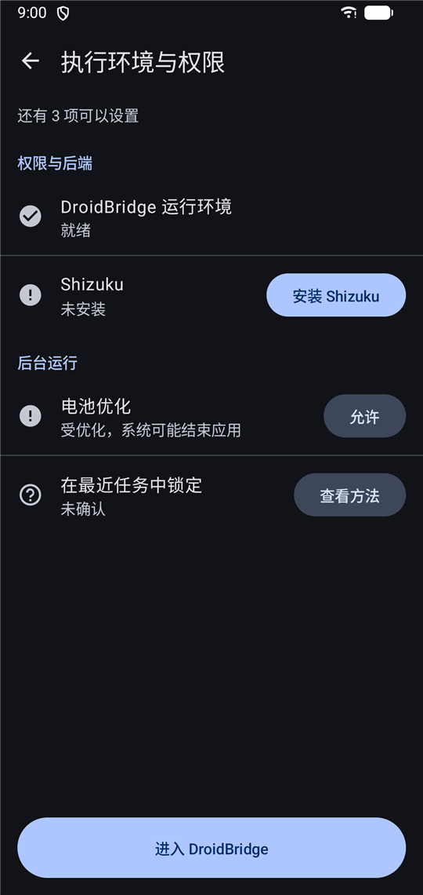
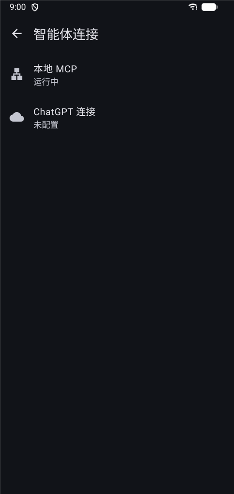
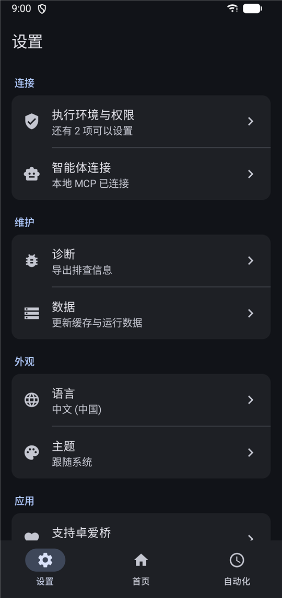

<p align="center">
  
</p>

<h1 align="center">卓爱桥 DroidBridge</h1>

<p align="center">
  <b>运行在手机上的 Android MCP 服务器。</b><br>
  通过 OpenAI 官方安全隧道连接 ChatGPT，让 AI 智能体操作你的手机，<br>
  并在手机本机运行定时自动化——不需要电脑，不需要 ADB。
</p>

<p align="center">
  <a href="LICENSE"></a>
  
  
  
  <a href="https://github.com/zephyr7030/DroidBridge/releases/latest"></a>
  <a href="https://github.com/zephyr7030/DroidBridge/releases"></a>
  <a href="https://t.me/anDroidBridge"></a>
  <a href="https://ko-fi.com/zephyr7030"></a>
</p>

<p align="center">
  <a href="README.md">English</a> · <b>简体中文</b>
</p>

<p align="center">
  
</p>

## 为什么选卓爱桥

- **ChatGPT 官方隧道。** 手机通过 HTTPS 主动向 OpenAI 的 Secure MCP Tunnel 取任务：不开放端口，
  不需要公网地址，中间没有我们自己的中转。
- **运行在手机上。** MCP 服务器和它驱动的一切都在设备里。只有想用电脑上的智能体时才需要电脑和 ADB。
- **比对话更持久的自动化。** 说一次，手机就按计划或事件一直做下去；Root 版由开机自启、不依赖任何 App 的后端执行。
- **权限恰好等于你授予的。** 没有额外的远程权限层，没有统计数据，开源（Apache-2.0）。

## 连接方式

两种连接方式并列：

| 连接方式 | 适用于 | 如何到达手机 |
|---|---|---|
| **ChatGPT** | 网页版 ChatGPT（开发者模式） | OpenAI 官方安全隧道（Secure MCP Tunnel）。手机通过 HTTPS 主动向 OpenAI 取任务，不开放端口，也不需要公网地址。 |
| **本地 MCP** | 同一台手机上的智能体，或通过 `adb forward` 连接的电脑 | `127.0.0.1:8765/mcp`（Root 版为 8766 端口）上的 Streamable HTTP，使用 Bearer 令牌。 |
## 智能体能做什么

| 工具 | 覆盖范围 |
|---|---|
| `context` | 卓爱桥状态、能力和工具目录 |
| `visual` | 观察屏幕（截图和界面层级）、点击、长按、滑动、输入文字、按键和组合键；输入可绑定到所观察的应用，并可用租约独占屏幕输入 |
| `android` | 查看应用、启动应用和 Intent、剪贴板、通知 |
| `filesystem` | 查看、读取、写入、编辑、移动、删除、ZIP 打包解包、下载文件 |
| `command` | 以应用或 Shell（Shizuku）身份运行命令；Root 版以 Root 身份运行 |
| `network` | DNS、TCP、TLS 诊断；抓包和注入流量（Root 版） |
| `automation` | 创建、修改、启用、删除和运行自动化（见下） |
| `task_control` | 列出、查看、取消后台任务 |

每个工具都带有 MCP 安全标注（`readOnlyHint`、`destructiveHint`、`openWorldHint`），ChatGPT 等客户端会在执行改动类操作前请你确认。

## 不依赖 AI 在线的自动化

对智能体说一次，手机就会一直做下去。自动化保存在设备上，运行时不需要智能体、电脑或打开的对话。

| | 可以搭建的内容 |
|---|---|
| **触发** | 某个时间点 · 每 N 分钟（1 分钟到 30 天）· 日历规则（RRULE，带时区）· 事件（`runtime.ready`、`network.default_changed`） |
| **步骤** | 调用工具动作（`visual` 的 interact 和 element，`android` 的启动与剪贴板，`filesystem` 的管理与下载，`command` 运行，`network` 诊断）· 顺序 · 按已保存状态、触发数据或上一步结果做条件分支 · 重复 · 延时 · 设置状态 · 每一步可选择失败时是否中止 |
| **控件步骤** | 在运行时按文字、描述或资源 ID 找到控件，再点击、长按或输入，所以保存的自动化不会持有过期引用 |
| **运行** | 每次最长一小时；状态在多次运行之间保留；每次运行都是一个可列出、查看、取消的任务 |
| **Root 版** | 后端开机自启，不依赖任何 App，为到点的运行设置唤醒闹钟，步骤可以用 Root 身份执行（Shell 命令） |

智能体用 `automation` → `save` 保存一个：

```json
{
  "name": "Morning check",
  "enabled": true,
  "trigger": {
    "type": "rrule",
    "rrule": "DTSTART:20261014T080000\nRRULE:FREQ=DAILY",
    "timezone": "Asia/Shanghai"
  },
  "action": {
    "type": "sequence",
    "children": [
      {"type": "call", "tool": "android", "action": "launch",
       "args": {"operation": "package", "package_name": "com.android.settings"}},
      {"type": "delay", "duration_ms": 3000},
      {"type": "call", "tool": "visual", "action": "element",
       "args": {"operation": "tap", "by": "text", "value": "Network & internet"}}
    ]
  }
}
```
## 选择版本

卓爱桥有两个版本：

- **卓爱桥** 是一个自己完成所有工作的 App。普通手机就能用，[Shizuku](https://shizuku.rikka.app/) 运行时还能获得 Shell 身份。
- **Root 版** 是一个 Root 模块。它的后端以 Root 身份独立运行，开机自启，不受任何 App 状态影响。安装模块时会一并安装
  **DroidBridge Root** App，用于查看后端状态和修改设置，本身不承担运行。

两个版本可以装在同一台手机上：卓爱桥的本地 MCP 使用 8765 端口，Root 版使用 8766 端口。

| | 卓爱桥 | 卓爱桥 + Shizuku | Root 版（Magisk / KernelSU / APatch） |
|---|---|---|---|
| 看屏幕 / 点击 / 输入 | 无障碍服务 | ✓（输入：仅 ASCII¹） | ✓ |
| 截屏 | 屏幕捕获授权 | ✓ | ✓ |
| 通知 | 通知使用权 | 通知使用权 | ✓ |
| Shell 命令 | 应用身份 | 应用和 Shell 身份 | Root 身份 |
| 抓包 / 注入 | — | — | ✓ |
| 后台保活 | 电池与自启动设置 | 保持到下次重启 | 独立运行，重启后自动恢复 |

¹ 通过 Shizuku 时，中文、Emoji 等非 ASCII 文字需要无障碍服务。

卓爱桥的 **执行环境与权限** 页会逐项引导：每一项都有直达对应系统设置的按钮，已被 Shizuku 覆盖的项目会自动隐藏。

## 系统要求

- Android 13 到 17，**arm64-v8a** 设备。卓爱桥 App 还带有 **x86_64** 库，可在 x86_64 模拟器上运行；Root 版仅支持 arm64-v8a。
- 连接 ChatGPT：需要支持网页开发者模式的套餐（Plus 及以上），以及在 OpenAI 平台创建的安全隧道和 Runtime API Key。
- 可选：[Shizuku](https://shizuku.rikka.app/)，以及 [Magisk](https://github.com/topjohnwu/Magisk)、[KernelSU](https://github.com/tiann/KernelSU) 或 [APatch](https://github.com/bmax121/APatch)，用于 Root 版。

## 安装

**卓爱桥**

1. 在[最新版本](https://github.com/zephyr7030/DroidBridge/releases/latest)（标签 `apk-v<版本>`）下载 `droidbridge-<版本>-arm64-v8a.apk` 并安装。
2. 打开卓爱桥，首次启动引导会让你选择智能体类型，并逐项完成权限设置。

版本附带 `SHA256SUMS.txt` 和签名的 `release.json`，App 的 **更新** 页会用签名校验自身更新。

**Root 版**

1. 在最新的 [`magisk-v` 版本](https://github.com/zephyr7030/DroidBridge/releases?q=magisk-v&expanded=true)中下载 `droidbridge-magisk-<版本>.zip`。
2. 在 Magisk、KernelSU 或 APatch 中安装模块，安装时会一并安装 DroidBridge Root App。
3. 重启手机，然后打开 DroidBridge Root。

模块更新由你的 Root 管理器提供。

## 连接 ChatGPT

1. 在 [OpenAI 平台](https://platform.openai.com/settings/organization/tunnels) 创建安全隧道，并创建一个可使用该隧道的 [API Key](https://platform.openai.com/api-keys)。
2. 在 App 中打开 **智能体连接 → ChatGPT 连接**，粘贴 Tunnel ID 和 Key，打开隧道。Key 之后不再显示：卓爱桥用 Android Keystore 加密保存，Root 版保存为仅 Root 可读。
3. 在电脑浏览器打开 [ChatGPT 安全设置](https://chatgpt.com/settings/security)，开启 **开发者模式**（对 Plus 账号仍在灰度测试）。
   再在 [ChatGPT 插件页](https://chatgpt.com/plugins) 点 **添加 → 创建 MCP 应用**，用你的隧道连接，认证选 **无**。App 页面上有这两个页面的链接。
4. 让 ChatGPT 使用卓爱桥，第一次调用会显示在 App 里。

## 连接本地智能体

1. 在 App 中打开 **智能体连接 → 本地 MCP**，打开并复制令牌。
2. 让 MCP 客户端连接 `http://127.0.0.1:8765/mcp`（Root 版为 `8766`），请求头 `Authorization: Bearer <令牌>`。从电脑连接时先转发端口：

   ```bash
   adb forward tcp:8765 tcp:8765
   ```

## 截图

| 首页 | 执行环境与权限 | 智能体连接 | 设置 |
|---|---|---|---|
|  |  |  |  |

## 安全与隐私

- 一切都在手机上运行。卓爱桥没有自己的服务器，也不上传任何统计数据。
- 智能体获得的权限**恰好**等于你在手机上授予的权限，没有额外的远程权限层可能配错。请只连接你信任的智能体。
- ChatGPT 隧道只通过 TLS 与 `api.openai.com` 通信，使用固定的 WebPKI 根证书库。
- 本地 MCP 只监听本机回环地址，必须携带令牌。
- 系统 `input` 命令无法输入的文字（例如中文、Emoji）会通过剪贴板粘贴：写入时标记为敏感内容，粘贴后恢复你原来的剪贴板。

发现安全问题请按 [SECURITY.md](SECURITY.md) 私下报告。

## 从源码构建

构建需要固定版本的工具链（JDK 17、Android SDK 37、NDK 29、Rust 1.98），目前脚本面向 Windows + PowerShell 7：

```bash
./gradlew :standalone:assembleDebug :root-frontend:assembleDebugMagiskModule
```

具体版本、libpcap 步骤和工具链检查见 [CONTRIBUTING.md](CONTRIBUTING.md)。
## 交流

提问、反馈设备情况、获取版本更新：欢迎加入 [Telegram 群组](https://t.me/anDroidBridge)。
问题报告请优先提交到 [GitHub Issues](https://github.com/zephyr7030/DroidBridge/issues)。

## 支持项目

卓爱桥由作者利用业余时间开发和维护。如果它对你有帮助，可以在 [Ko-fi](https://ko-fi.com/zephyr7030) 上支持。提交问题和设备报告同样很有帮助。

## 许可证

卓爱桥以 [Apache License 2.0](LICENSE) 授权。第三方组件及其许可证见 [THIRD_PARTY_NOTICES.txt](THIRD_PARTY_NOTICES.txt)。

卓爱桥是独立项目，与 OpenAI、Anthropic、Google、Magisk、Shizuku 均无隶属或背书关系。文中产品名称归各自所有者所有。
